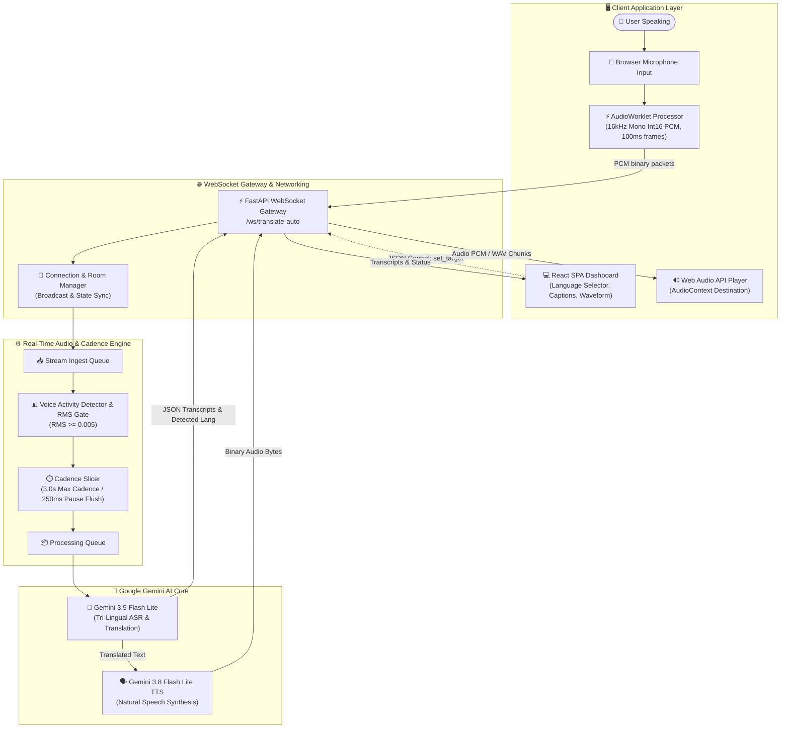
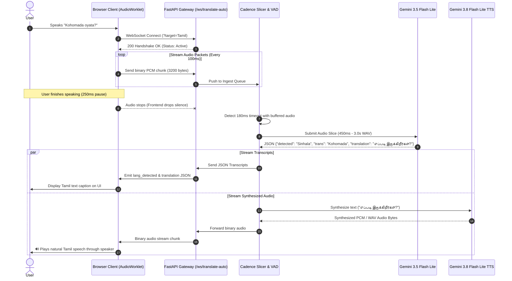
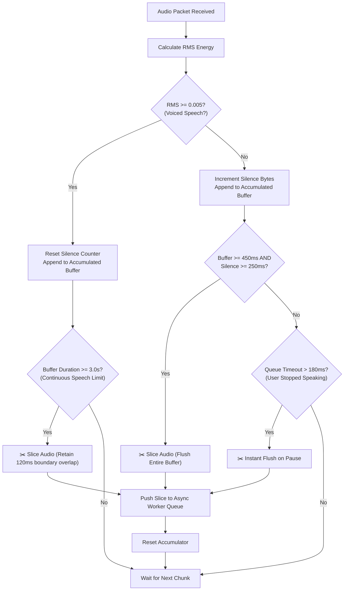
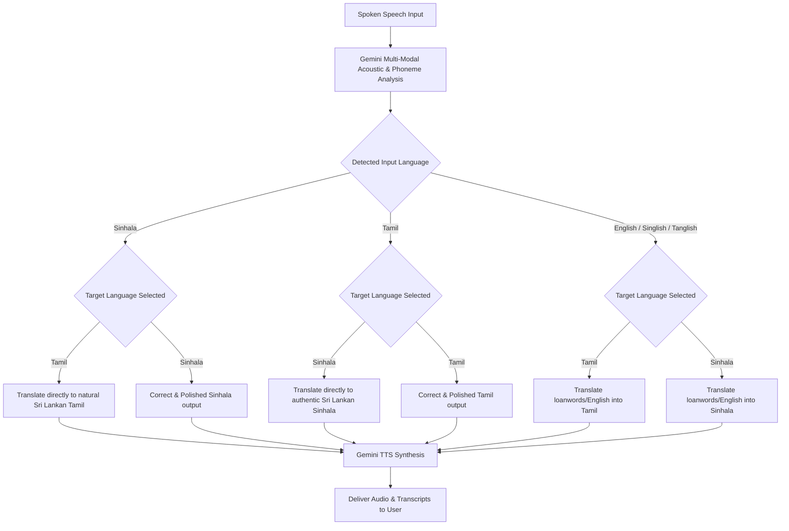
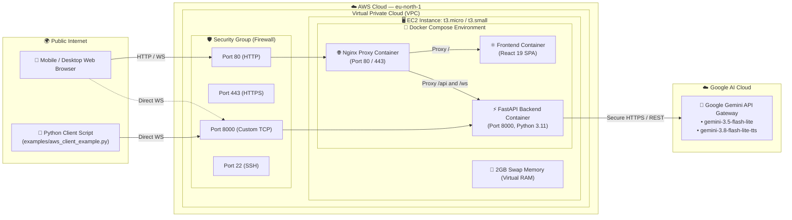

# 🏛️ System Architecture & Engineering Flowcharts

This document details the architectural design, data pipelines, sequence lifecycles, and deployment topologies of the **Sinhala ↔ Tamil Real-Time Continuous Voice Translator (SinTam)**.

---

## 1. High-Level System Architecture

The following flowchart illustrates the complete component layout, from the user's microphone to the browser audio playback and external AI model layers:

---

## 2. End-to-End WebSocket Sequence Diagram

This sequence diagram depicts the chronological message exchange between the Client, the FastAPI Backend, and the Google Gemini AI APIs:

---

## 3. Cadence Slicing & Voice Activity Decision Flowchart

How the continuous engine prevents latency and slices speech without waiting for users to finish:

---

## 4. Tri-Lingual Language Detection & Output Routing

The decision logic determining which language was spoken and how the translation is targeted:

---

## 5. AWS EC2 Cloud Deployment Topology

The infrastructure topology currently deployed and serving traffic on AWS:

---

## 6. Summary of Architectural Guarantees

1. **Sub-3-Second Turnaround**: Slicing cadence + `gemini-3.5-flash-lite` + `gemini-3.8-flash-lite-tts` provides near-instant continuous translation without blocking the conversation.
2. **Full Duplex Audio**: User can speak non-stop without pausing; the system ingests audio in the background and speaks translated responses concurrently.
3. **No Disconnect on Language Toggle**: The target language can be switched between Tamil and Sinhala dynamically in real time without tearing down the WebSocket connection.
