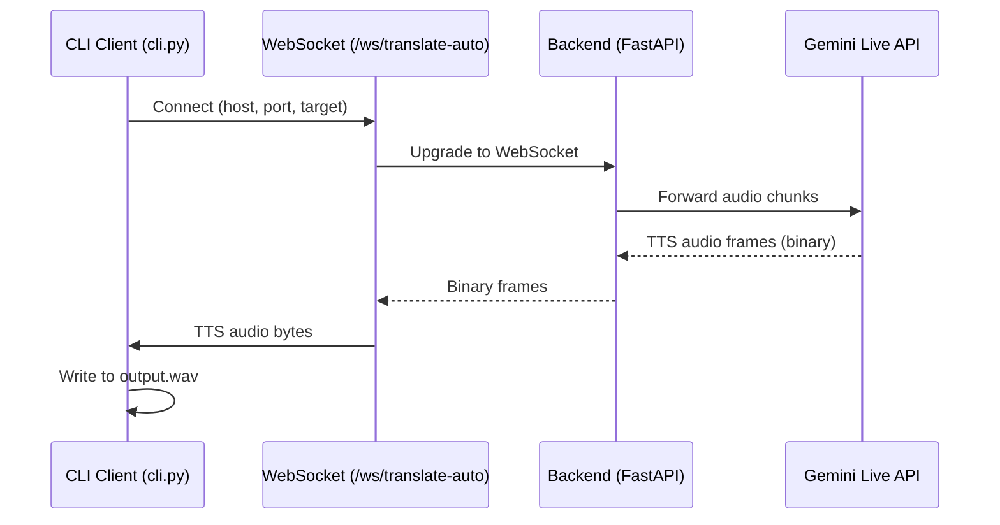

# Project Overview – Tamil‑Sinhala Voice Translator

## Introduction
This repository implements a real‑time voice translation system between Tamil and Sinhala using a FastAPI backend that exposes WebSocket endpoints and a lightweight Python CLI client (`cli.py`). The client streams PCM audio to the backend, which forwards it to the Gemini Live API for translation and text‑to‑speech synthesis.

## Architecture


## Roadmap & Milestones
- **Current**: CLI client works with dummy PCM, backend ready.
- **Next**:
  1. Add unit tests for end‑to‑end integration.
  2. Publish Docker image for backend.
  3. Create CI pipeline (GitHub Actions) to run tests on push.
  4. Generate PDF documentation for stakeholders.

## Data Flow & Models
- **Audio Input**: 16 kHz, mono, 16‑bit PCM (`sample.pcm`).
- **WebSocket Messages**:
  - JSON status messages (e.g., `{"type":"status","payload":"ready"}`).
  - Binary frames containing raw WAV data from Gemini.
- **Configuration**: API keys stored in `api_keys.db`; optional `GEMINI_API_KEY` env var.

## Code Walkthrough
### `translate_client.py`
- `translate(host, port, target)`: simple demo that switches target language.
- `translate_file(host, port, target)`: now uses two helpers:
  - `_stream_audio(ws, audio_path)`: streams PCM chunks.
  - `_collect_tts(ws, output_path)`: collects binary frames and writes a WAV file.

### `cli.py`
- Argument parsing (`--host`, `--port`, `--target`, `--audio`, `--output`).
- `--run-backend` flag starts the FastAPI server in a subprocess before the client runs and shuts it down afterwards.
- `--no-dummy` disables automatic dummy PCM creation.
- Overrides `translate_client.AUDIO_PCM` and `translate_client.OUTPUT_WAV` so the helpers use the supplied paths.

### Backend (`backend/main.py`)
- FastAPI app with CORS, API‑key security, and multiple WebSocket endpoints (`/ws/translate-auto`, `/ws/translate`, etc.).
- `handle_auto_translation_stream` and related handlers manage streaming to Gemini and sending back audio.

## Running the Project
1. **Start the backend** (optional if you use `--run-backend`):
   ```bash
   uvicorn backend.main:app --host 127.0.0.1 --port 8000
   ```
2. **Run the client**:
   ```bash
   # Basic run – creates dummy PCM if missing
   python cli.py
   # Custom run with real audio and target language
   python cli.py --audio my_recording.pcm --target Sinhala --output sinhala.wav
   # Let the CLI start the backend for you
   python cli.py --run-backend
   ```
3. After execution, `output.wav` (or the file you specified) will contain the translated speech.

## PDF Generation Prompt (for AI tools)
```
Create a professional PDF document titled "Tamil‑Sinhala Voice Translator – Project Overview" using the content from PROJECT_OVERVIEW.md. Include the Mermaid sequence diagram as an image, format headings with a clean hierarchy, and add a cover page with the project name, date, and a brief abstract. Use a modern, clean layout suitable for a technical stakeholder presentation.
```
